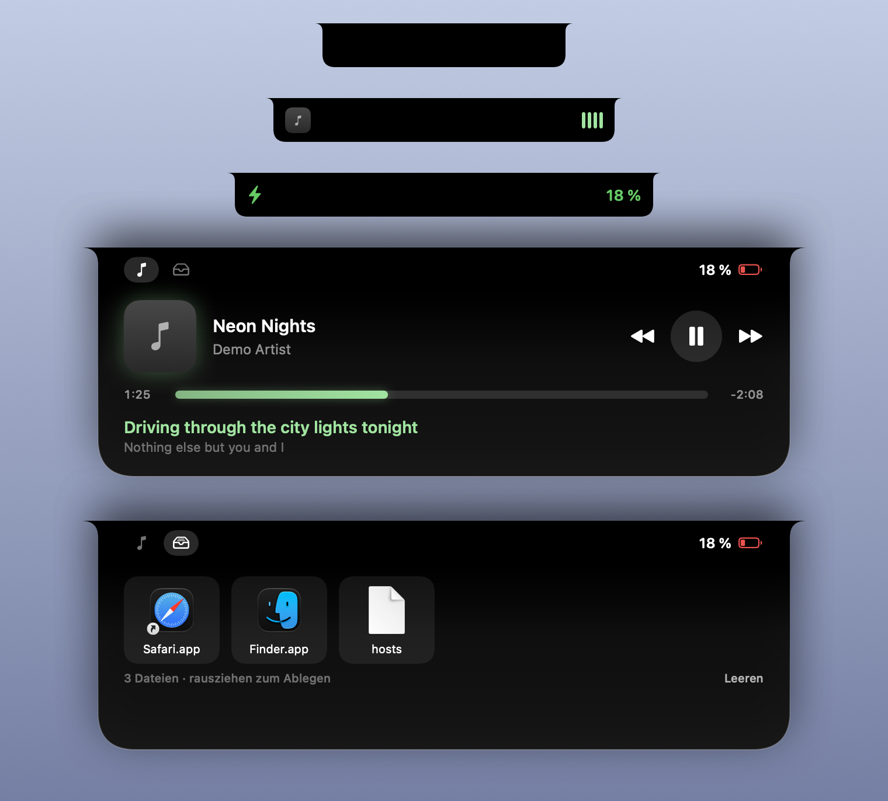

# Insel

Eine „Dynamic Island“ für die Notch des MacBooks – mit Musik-Player, Live-Lyrics, Datei-Ablage, Akku-, AirPods- und Wetteranzeige.



## Funktionen

- **Musik-Player** für Apple Music, Spotify und eSound: Cover, Titel, Fortschrittsbalken zum Spulen, Play/Pause/Weiter/Zurück
- **Live-Lyrics**, synchron zur Wiedergabe (von eSound selbst oder über [LRCLIB](https://lrclib.net)); gibt es nur ungetimten Text, wird er über den Song verteilt
- **Ablage**: Dateien auf die Notch ziehen, später wieder herausziehen
- **Hinweise**, wenn das Ladekabel eingesteckt wird oder AirPods sich verbinden (mit Akkustand)
- **Wetter** über [Open-Meteo](https://open-meteo.com) – kostenlos, ohne Account
- **Liquid Glass** (macOS 26+), animiert mit SwiftUI und Core Animation, < 1 % CPU

Fährt man mit der Maus auf die Notch, klappt die Insel auf.

## Einstellungen

Über das Zahnrad in der ausgeklappten Insel oder per Rechtsklick → *Einstellungen …* öffnet sich ein Fenster im Stil der macOS-Systemeinstellungen. Alles wirkt sofort, ohne Neustart:

- **Allgemein:** beim Login starten, Öffnen-/Schließen-Verzögerung, Ablage, Akkuanzeige, Lade- und AirPods-Hinweise
- **Musik:** Quellen (Apple Music, Spotify, eSound), Equalizer, Lyrics und Lyrics-Versatz
- **Aussehen:** Liquid Glass und Abdunkelung, Akzentfarbe (aus dem Cover oder eigene), Dicke des Fortschrittsbalkens
- **Wetter:** an/aus, Stadt oder aktueller Standort, °C/°F

## Entstehung

Die Insel ist mit **[Claude Code](https://claude.com/claude-code) (KI) gebaut** – den Code hat die KI geschrieben.
Von mir stammen Idee und Anforderungen, das Testen im Alltag, Fehlerberichte und die Design-Entscheidungen.
Auslöser war, dass ich eine kostenlose Notch-App wollte, die auch eSound unterstützt.

## Installation

Voraussetzung: macOS 14 oder neuer auf einem Mac mit Notch (ohne Notch erscheint die Insel beim Hovern oben mittig) und die Xcode Command Line Tools (`xcode-select --install`).

```bash
git clone https://github.com/memooooo43/insel.git
cd insel
./install.sh              # bauen, nach ~/Applications installieren, starten
./install.sh --autostart  # zusätzlich bei jedem Login starten
./install.sh --uninstall  # alles wieder entfernen
```

Beim ersten Benutzen fragt macOS nach:

- **Ortungsdiensten** – fürs Wetter (alternativ per Rechtsklick eine Stadt festlegen)
- **Automation** – um Apple Music bzw. Spotify anzuzeigen und zu steuern
- **Bedienungshilfen** – um eSound zu steuern (unter *Datenschutz & Sicherheit → Bedienungshilfen* erlauben)

## Wie es funktioniert

| Teil | Quelle |
|---|---|
| Apple Music, Spotify | AppleScript |
| eSound | liest `esound_playback.json` (wird beim Abspielen jede Sekunde geschrieben); steuert über das eSound-Menü „Wiedergabe“ per Bedienungshilfen |
| Akku | IOKit Power Sources |
| AirPods | `system_profiler SPBluetoothDataType` |
| Lyrics | eSound bzw. LRCLIB |

Bekannte Grenzen: Bei eSound lässt sich nur in 15-Sekunden-Schritten spulen; eine Pause per Medientaste wird erst nach etwa 1,5 Sekunden erkannt (sonst sofort).

## Aufbau

```
Sources/Insel/
├── main.swift      App, Panel an der Notch, Hover-Erkennung
├── Island.swift    Oberfläche (SwiftUI)
├── Services.swift  Musik, Lyrics, Akku, AirPods, Wetter, Ablage
└── ESound.swift    eSound-Steuerung über Bedienungshilfen
```
